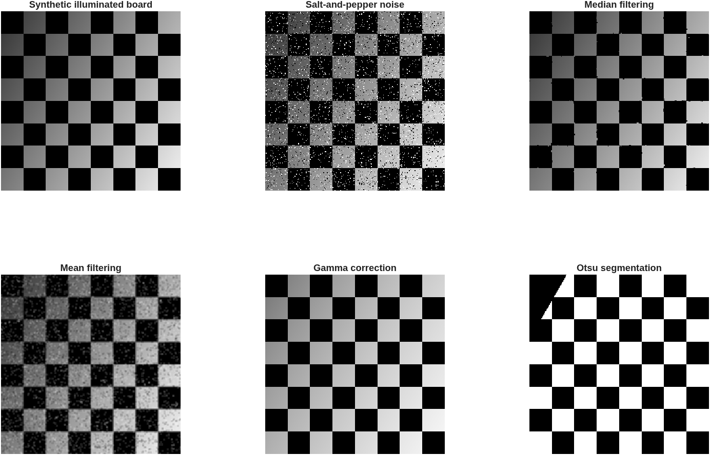
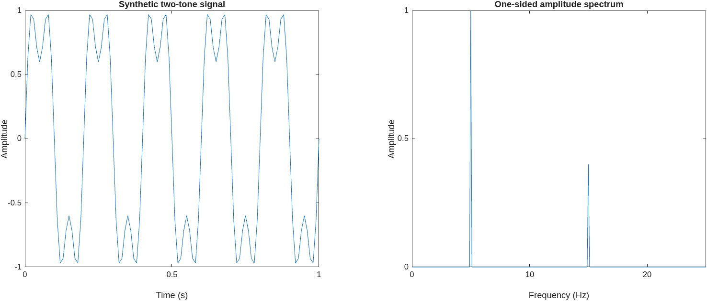

# Signal and Image Processing

[](https://github.com/jorge-barb-pereira/signal-and-image-processing/actions/workflows/matlab.yml)

A MATLAB portfolio spanning synthetic image construction, contrast enhancement, segmentation, morphology, signal analysis, digital filtering, resampling and volume visualization. The collection originates from **Processamento de Sinal e Imagem**, with source modification dates in **February–June 2021**.

This repository combines the submitted coursework with an English-language maintained library, synthetic demonstrations, regression tests and a documented review. The maintained edition was prepared on **18 October 2026**; it is distinguished from the original academic work.

## Explore the collection

| Section | Topics | Available source |
| --- | --- | --- |
| TP0 | MATLAB basics, random simulation and image representations | Preliminary course notes |
| TP1 | Checkerboards, directional illumination, contrast, histogram transforms and denoising | Submitted MATLAB exercises |
| TP2 | RGB/HSV analysis, spatial statistics, projections and global/local segmentation | Submitted MATLAB exercises |
| TP3 | Object labeling, border exclusion, morphology, image rotation and animation | Submitted MATLAB exercises |
| TP4 | Complex signals, energy/norms, smoothing and cross-correlation | Submitted MATLAB exercises |
| TP5 | FFT analysis, convolution and ideal/FIR/IIR filtering | Submitted MATLAB exercises |
| TP6 | Audio/EEG analysis, interpolation, resampling and NIfTI-volume experiments | Submitted MATLAB exercises; original datasets excluded |

See the [coursework catalog](docs/COURSEWORK.md) for dependencies and examples, and the [source review](docs/REVIEW.md) for known issues and the maintained replacements.

## Quick start

Use MATLAB R2021a or later with **Image Processing Toolbox**. The full historical collection also uses **Signal Processing Toolbox** and optional external data/loaders. GNU Octave compatibility has not been established.

From this repository's root in MATLAB:

```matlab
addpath('matlab');
addpath('examples');
run_demo('output/demo');
```

The demo creates synthetic grayscale/RGB images, noisy/filtered/segmented comparisons, a two-tone signal spectrum and a MAT file of generated values. No original recordings, medical scans, photographs or audio are required.

These previews were generated by MATLAB during the successful CI run:





```matlab
addpath('matlab');
image = sipi.checkerboard_image(256, 0.2, 0.95, 30);
[mean_image, median_image] = sipi.denoise_image(image, 3);
[mask, threshold] = sipi.segment_image(image);
[frequency, amplitude] = sipi.amplitude_spectrum(sin(2*pi*5*(0:999)/100), 100);
```

## Maintained functions

| Function | Behavior |
| --- | --- |
| `sipi.checkerboard_image` | Eight-by-eight board with a directional intensity ramp |
| `sipi.contrast_stretch` / `sipi.gamma_transform` | Validated grayscale enhancement |
| `sipi.denoise_image` | Mean/median filtering with symmetric boundaries |
| `sipi.segment_image` | Otsu segmentation after normalization |
| `sipi.relative_error` | Symmetric zero-padding, shape normalization and explicit zero-reference behavior |
| `sipi.linear_interpolate` | Endpoint-aware interpolation with interval validation |
| `sipi.resample_linear` | Sample-index interpolation; no anti-aliasing filter |
| `sipi.amplitude_spectrum` | One-sided real-signal spectrum with correct DC/Nyquist scaling |
| `sipi.fft_convolve` | Linear convolution with sufficient zero-padding |

## Run tests

```matlab
results = runtests('tests');
assertSuccess(results);
```

The tests cover numerical identities, edge cases, filtering and a limited comparison with original helpers. The [MATLAB workflow](.github/workflows/matlab.yml) runs tests and generates demo artifacts. See the [validation report](docs/VALIDATION.md) for the tested scope and limitations.

## Structure and provenance

```text
coursework/TP0–TP6/   Preserved historical MATLAB source
matlab/+sipi/        Maintained, reusable English-language functions
examples/           Self-contained synthetic demonstrations
tests/              MATLAB regression tests
docs/               Catalog, review, chronology and validation
tools/              Source import and publication audit utilities
```

Historical source is preserved verbatim, including its Portuguese comments, labels and filenames. English documentation and maintained functions provide the current project interface. Preserving source does not imply that every exercise has been repaired or executed. Some original scripts expect local files and interactive figures.

Dates are supported by original filesystem metadata and [SHA-256 records](docs/source-provenance.json), not reconstructed historical commits. Instructor solutions, copied NIfTI utilities, assignment PDFs, reports, recordings and image datasets are not published. TP0 is identified as preliminary notes rather than claimed as individually authored work. See [provenance](docs/PROVENANCE.md) and [attribution](THIRD_PARTY_NOTICES.md).
